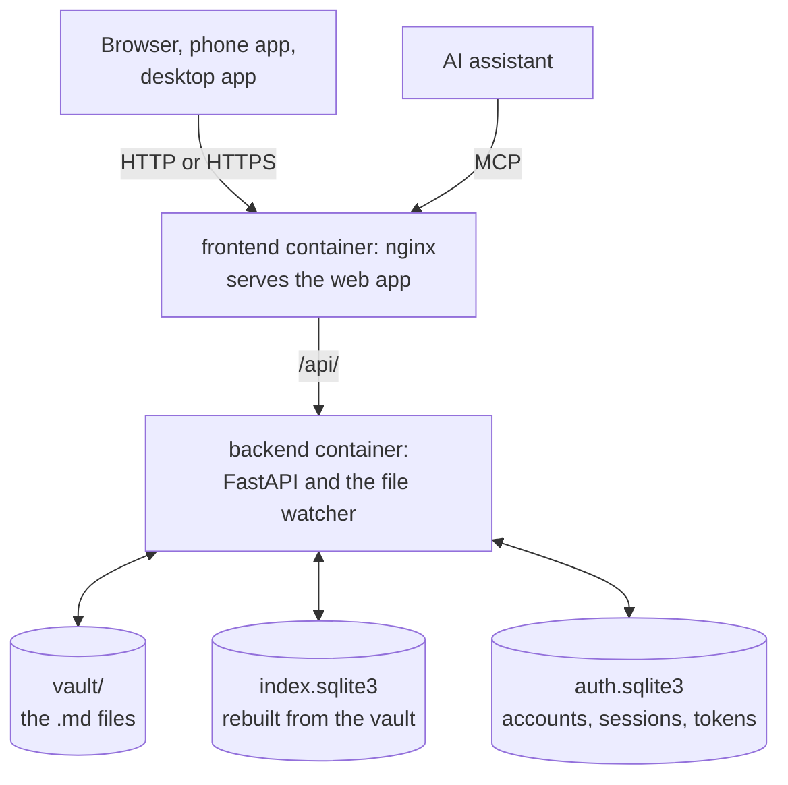

# Architecture

An overview of how the pieces fit. The decisions behind them, and their
trade-offs, are in
[SPEC.md](https://github.com/piurizza/cerebrum/blob/main/SPEC.md).

## The vault is the source of truth

Notes are `.md` files in the vault folder. Everything else is derived from
them, except accounts:

- **The index** (`index.sqlite3`) holds note metadata, links, wikilinks,
  tasks and a full-text search table. It's rebuilt from the vault on every
  start and can be deleted at any time.
- **The accounts database** (`auth.sqlite3`) holds accounts, sessions, API
  tokens, invites and identity-provider links. It's the one thing that can't be
  rebuilt.

Every write saves the file first, then updates the index. A file watcher
indexes changes made outside Cerebrum, and a rescan every few minutes catches
anything it missed.

## Backend

`backend/src/cerebrum/`, a FastAPI app served by uvicorn.

| Package | Does |
|---|---|
| `notes/` | Reads, writes, moves and deletes notes; parses frontmatter, links and wikilinks; rewrites links on rename. |
| `index/` | The SQLite index, the startup rebuild, the file watcher and rename detection. |
| `accounts/` | Accounts, sessions, API tokens, invites and identity-provider sign-in. |
| `attachments/` | Saving and serving pasted images. |
| `api/` | The REST routes, under `/api`. |
| `mcp/` | The MCP server and its tools, under `/api/mcp`. |

The REST API is described in the [REST API reference](../reference/rest-api.md),
generated from the backend's OpenAPI schema.

## Frontend

`frontend/src/`, a React single-page app.

- **CodeMirror 6** for editing, **react-markdown** for the preview,
  **mermaid** for diagrams, loaded only when a note has one.
- **react-force-graph** for the graph.
- A service worker caches the app and the vault for offline reading and makes
  it installable on phones.
- TypeScript types for the API are generated from the backend's schema
  (`make generate-api-types`); CI fails when they're out of date.

In Docker, nginx serves the built app and forwards `/api/` to the backend. It
also serves HTTPS with a self-signed certificate made on first start.

## Desktop app

`desktop/`, a Tauri v2 app. It doesn't bundle Cerebrum: its window opens the
server's address, so the web app and its sign-in work unchanged. The only
bundled screen is the one that asks for the server address.

## Shared rules

Some rules exist in both Python and TypeScript, such as how a wikilink finds
its note and how the search box parses `#tags`. Both implementations run the
same cases from `fixtures/`, so they can't drift apart.
