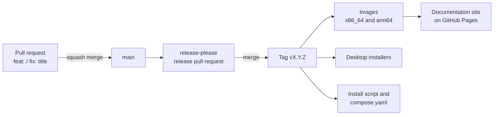

# Releases

Releases are made by
[release-please](https://github.com/googleapis/release-please) from the commit
history on `main`.

## How a release happens

1. Pull requests are squash-merged with a
   [Conventional Commits](https://www.conventionalcommits.org) title:
   `feat:` for a new feature, `fix:` for a fix, `feat!:` or a
   `BREAKING CHANGE:` footer for a breaking change, and `docs:`, `ci:`,
   `test:` or `chore:` for changes users don't see.
2. release-please keeps a release pull request open, with the next version
   number and the changelog. Before 1.0, a breaking change bumps the minor
   version.
3. Merging that pull request tags the release. The release workflow then:
    - builds and publishes the images for x86_64 and arm64, with build
      attestations;
    - builds the desktop installers for Linux, macOS and Windows;
    - attaches the install script and `compose.yaml`;
    - builds this documentation site and publishes it to GitHub Pages.

## Upgrade notes come first

Every release needs an upgrade page, `website/docs/upgrade/<version>.md`, also
listed in `website/zensical.toml`. A test fails when `CHANGELOG.md` names a
version without one, and the release workflow runs that test before publishing
the site.

Add the next version's page in an ordinary pull request **before** merging the
release pull request, never on the release branch itself: release-please
rewrites that branch on every push to `main`.

## Fixing published docs

The site always shows the latest release. To correct it between feature
releases, merge a `fix(docs): ...` pull request: release-please turns it into
a patch release, which republishes the site.

A manual run of the release workflow with **docs only** set rebuilds and
republishes the site for the current release without touching images or
installers.
