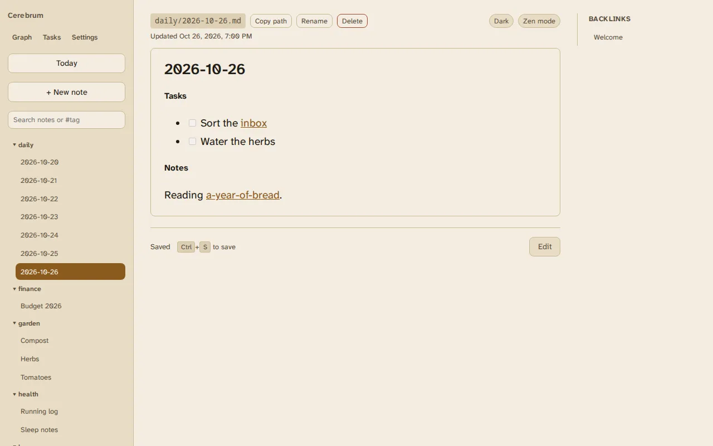

# Daily notes

**Today** opens today's note, creating it if it doesn't exist yet. A new daily
note starts with the full date as its heading; an existing one is never
overwritten.

Daily notes are named by date, `daily/2026-10-26.md`, so they sort in order in
the folder tree. "Today" is your device's calendar day, not the server's, so
it's right even when the server is in another time zone.

The folder is set on the server by `CEREBRUM_DAILY_NOTE_FOLDER` (default
`daily`). Changing it needs only a restart.

Daily notes work well with [tasks](tasks.md): checkboxes you write in them show
up in the task list until you tick them off.
