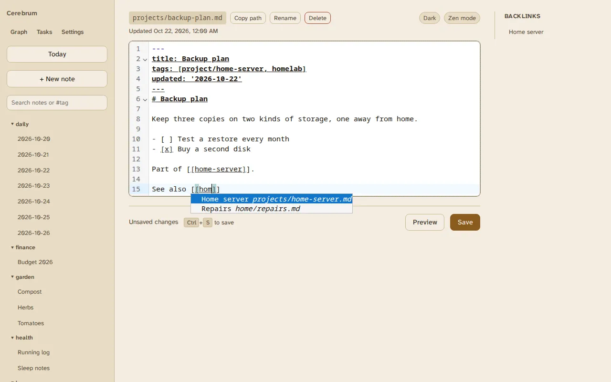

# Links

Notes link to each other, and those links drive backlinks, the
[graph](graph.md) and renames.

## Writing a link

Type `[[` while editing and pick a note from the list. Keep typing to narrow
it down.



By default Cerebrum writes a standard markdown link, which any markdown viewer
understands:

```markdown
[Home server](projects/home-server.md)
```

The path is relative to the note you're writing in.

## Wikilinks

Cerebrum also reads Obsidian-style wikilinks, so a vault imported from Obsidian
arrives linked:

| You write | Links to |
|---|---|
| `[[home-server]]` | The note named `home-server.md`, wherever it is |
| `[[home-server\|my server]]` | The same note, shown as "my server" |
| `[[home-server#Tasks]]` | The same note |
| `[[projects/home-server]]` | The note at that path, or ending in it |
| `[[#Tasks]]` | A heading in the same note |
| `![[photo.png]]` | Shows the image `photo.png`, found by name |

A wikilink names a note by **file name**, not by title, and ignores case. When
two notes share a name, the one in the linking note's folder wins, then the one
with the shortest path.

To have the `[[` picker and AI assistants write wikilinks instead of markdown
links, set `CEREBRUM_LINK_FORMAT=wikilink` and restart. Existing links are
never converted.

## Backlinks

The **Backlinks** panel next to a note lists every note that links to it.

## Renames keep links working

Renaming or moving a note, in Cerebrum or on disk, updates the links that
pointed at it:

- markdown links are rewritten to the new path;
- wikilinks are rewritten only where they would stop finding the note, keeping
  their shown text and heading.

A rename made outside Cerebrum is recognised when the file's content is
unchanged and the move completes within 30 seconds
(`WATCHER_RENAME_PAIRING_WINDOW_SECONDS`). A rename that also changes the text
counts as a delete plus a new note.

## Unresolved links

A link to a note that doesn't exist yet is kept. The preview marks it, and the
graph shows it as a ghost node. Deleting a note leaves the links to it in
place, unresolved.

## Known limits

- **File names with spaces.** A markdown link only counts when its target has
  no spaces: `[x](my-note.md)` works, but `[x](My Note.md)`,
  `[x](My%20Note.md)` and `[x](<My Note.md>)` are not followed. Wikilinks
  such as `[[My Note]]` work with any name. Prefer file
  names without spaces, or `CEREBRUM_LINK_FORMAT=wikilink`.
- Links inside notes in hidden folders, such as `.trash/`, are not updated
  when the note they point at moves.
- Relative wikilinks such as `[[../Note]]` are not supported.
