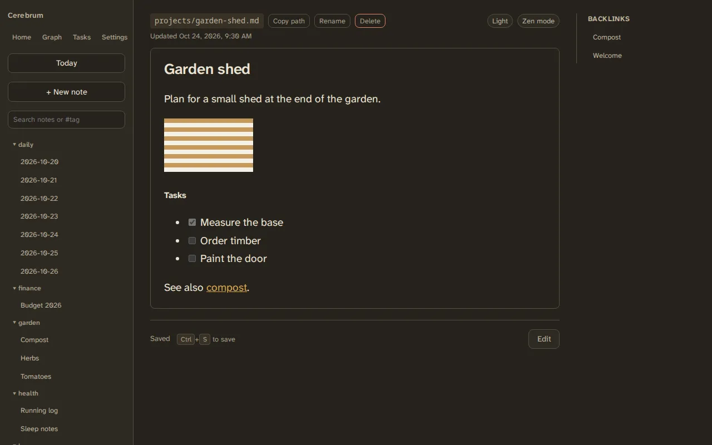
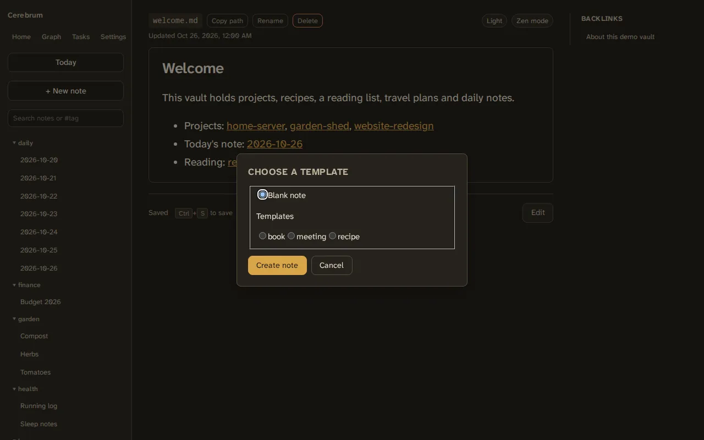

# Notes and templates



## Reading and writing

A note opens as a rendered preview. Choose **Edit** to change it, then
**Save**, or press ++ctrl+s++ (++cmd+s++ on a Mac) from anywhere on the page.
"Unsaved changes" under the editor tells you when there is something to save.

If the note was changed somewhere else while you were editing, on another
device or by an assistant, saving keeps both: changes to other lines are
merged in. When both touched the same lines, Cerebrum asks. **Reload** opens
the note as it is now and leaves your text on screen to copy; **Keep mine**
saves your version over it.

The preview understands standard markdown with tables, task lists and
strikethrough, plus:

- links to other notes, which open inside Cerebrum (see [Links](links.md));
- images, scaled to fit the page;
- ` ```mermaid ` code blocks, drawn as diagrams. A diagram with a mistake shows
  the error and its source.

**Zen mode** hides everything but the note; **Dark** switches the theme.

## Creating a note

Choose **+ New note**. Pick a folder, or create one, and type a file name. If
the vault has [templates](#templates), Cerebrum then asks which one to start
from. The new note opens; choose **Edit** to write in it.

## Images

Paste an image while editing and Cerebrum uploads it and inserts the link. The
image is saved next to the note in a folder named `<note name>.attachments/`,
so `garden-shed.md` keeps its images in `garden-shed.attachments/`. The folder
moves with the note and is deleted with it.

Images are limited to 10 MB each (`MAX_ATTACHMENT_SIZE_BYTES`). In Docker,
the bundled web server also caps uploads at 10 MB, so the setting can lower
the limit but not raise it.

## Renaming, moving and deleting

- **Rename** changes a note's title, its file name, its folder, or all three.
  Every link to it in other notes is updated, and its images move with it.
- **Copy path** copies the note's path, for linking from elsewhere.
- **Delete** asks once, then removes the note and its images. Links to it in
  other notes stay, shown as unresolved.

## Templates

A template is an ordinary note in the `templates` folder. When you create a
note, Cerebrum offers the templates that apply, and the new note starts with a
copy of the template's text and frontmatter, apart from its title and creation
date.



- A template directly in `templates/` is offered for every new note.
- A template in a subfolder, such as `templates/recipes/`, is offered first
  for notes created in a folder with the same name, and after the others
  elsewhere.
- With no templates, **+ New note** just creates an empty note.

The folder is set by `CEREBRUM_TEMPLATES_FOLDER` (default `templates`). If you
already have an unrelated folder with that name, choose another one before you
start: every note in it becomes a template.

## Known limits

- Template placeholders such as `{{date}}` are not filled in; the text is
  copied as it is.
- Templates are normal notes, so they also show up in search, tags and the
  graph. Their checkboxes are left out of [Tasks](tasks.md).
