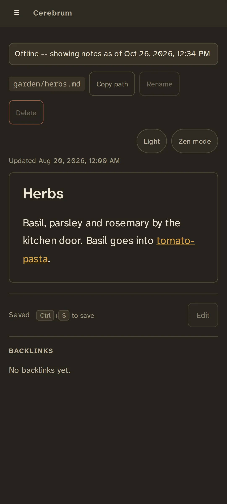

# Offline use

Once you've signed in over HTTPS, Cerebrum keeps a copy of your vault in the
browser or the phone app. If the server can't be reached, you can still open
and read every note, with a banner that says how old the copy is.

{ width="320" }

- The copy refreshes each time you open Cerebrum with a connection.
- Offline, you can read notes, browse the folder tree and filter by
  [tag](tags-and-search.md#filtering-by-tag). Searching for words needs the
  server.
- You can't edit offline: **Edit**, **Rename**, **Delete** and **+ New note**
  are disabled until the server is back.
- Mermaid diagrams show offline only if you've viewed a diagram online
  before.

Offline use needs a secure address: HTTPS, or `localhost` on the server itself.
See [HTTPS](../running/https.md).

Cerebrum is one server that every device reaches. There is no offline editing
and no sync between devices' copies: that's a deliberate choice that keeps
your notes in one place.
