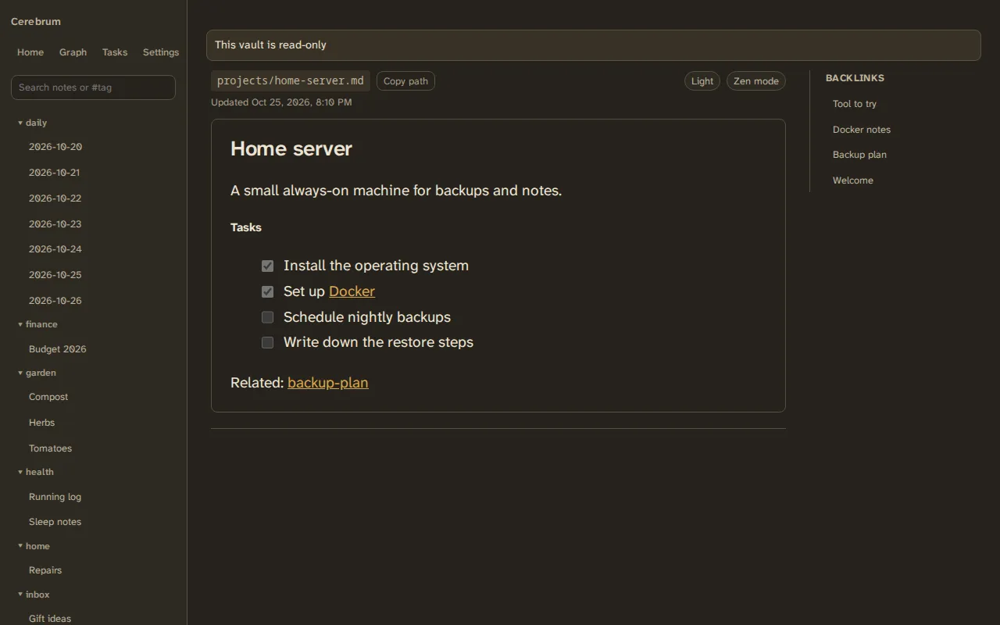

# Read-only vault

A server can run Cerebrum over a vault it must never change, such as a git
repository another tool keeps up to date. Everyone can still read, search and
browse it.

What you see:

- a "This vault is read-only" banner;
- no **Today**, **+ New note**, **Edit**, **Rename** or **Delete**;
- search, tags, the graph, tasks and backlinks work as usual;
- your account, password and API tokens work as usual.

AI assistants connected over MCP get only the reading tools.

To set it up, see
[Read-only vault and a second instance](../running/read-only-and-second-instance.md).
