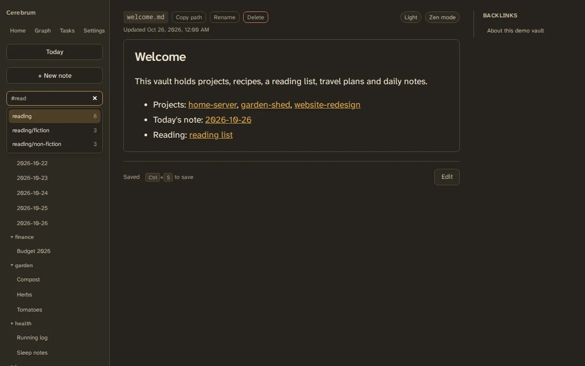

# Tags and search

## Tags

Tags live in a note's frontmatter:

```markdown
---
tags: [reading/fiction, favourite]
---
```

A `/` nests tags: `reading/fiction` is inside `reading`. Tags ignore case.

!!! note
    Tags written in a note's text, such as `#idea` in a sentence, are not read
    as tags. Only the frontmatter counts.

## Searching

The search box at the top of the sidebar searches note titles and text as you
type. Each word must appear, and a word also matches longer words that start
with it: `garden sh` finds "garden shed".

Results are ranked by relevance. Clear the box to get the folder tree back.

## Filtering by tag

Type `#` in the search box to see your tags, with how many notes carry each.



Pick one, or finish typing a tag and press space, and it becomes a chip. Then:

- with only tags, the folder tree shows just the notes that carry them, and
  this works offline;
- with tags and words, you get the ranked list of notes that carry the tags
  and contain the words.

| Query | Finds notes |
|---|---|
| `#reading` | Tagged `reading` or anything under it, such as `reading/fiction` |
| `#reading #favourite` | Carrying both tags |
| `#reading -#fiction` | Tagged `reading`, but not `fiction` |
| `#"two words"` | Tagged with a tag that contains a space |
| `bread #cooking` | Tagged `cooking` and containing "bread" |

`#work` doesn't match `workshop`. A `#` only starts a tag at the start of the
box or after a space, and a tag needs more than digits, so `issue #42` searches
for words.

The same syntax works over the [REST API](../reference/rest-api.md) and in the
[MCP](../agents/mcp-tools.md) `search-notes` tool.

To browse by tag instead, see the [tag front page](tag-front-page.md).
