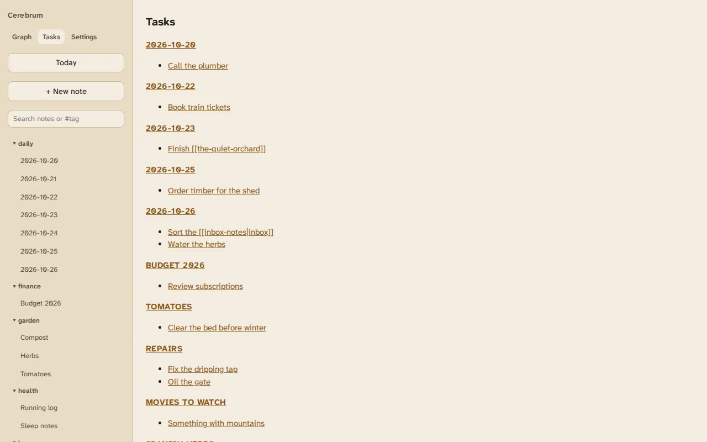
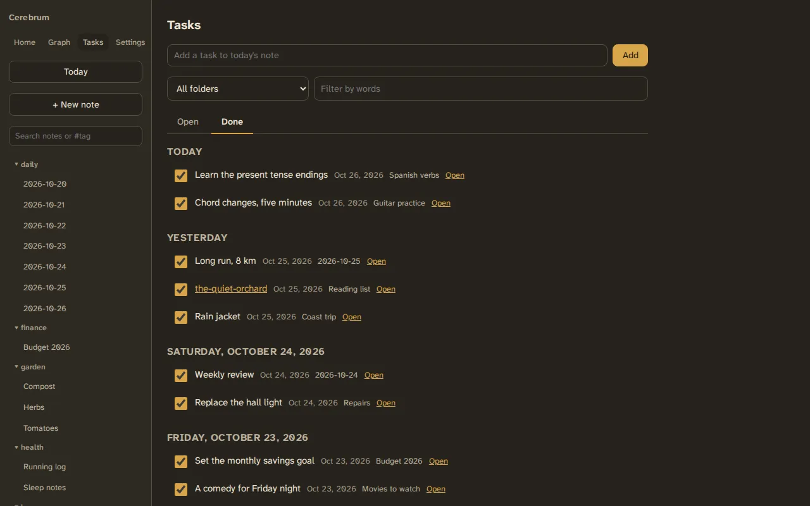

# Tasks

**Tasks** is one list of the tasks in every note: add them, tick them off and
look back at what you finished. A task is a markdown checkbox, written
anywhere in a note:

```markdown
- [ ] Schedule nightly backups
- [x] Buy a second disk ✅ 2026-10-26
```

`*` and `+` work in place of `-`.



## Adding a task

Type in the box at the top and press ++enter++. The task goes at the end of
today's [daily note](daily-notes.md), which is created if it doesn't exist
yet. The box keeps the cursor, so you can add several in a row.

A task you just added stays in the list even when the filters would hide it,
marked "Outside the current filters".

## Ticking a task off

Tick its checkbox. The line in the note becomes:

```markdown
- [x] Water the herbs ✅ 2026-10-26
```

The date is the day you ticked it, on your device's calendar. It's the same
marker the Obsidian Tasks plugin writes. Only that line changes: the rest of
the note, and its updated date, stay as they were.

For 5 seconds the task stays in place with **Undo**. Unticking a task removes
its date.

If the note was changed since the list loaded and that line no longer holds
the task, nothing is written. Cerebrum says so and reloads the list.

You can also tick and untick tasks in a note's preview. While the note has
unsaved edits, its checkboxes wait until you save.

## Open and Done

**Open** lists every task not yet ticked, grouped by note. **Done** lists the
tasks ticked in the last 14 days, newest first, under Today, Yesterday and
each earlier date.



A task's text shows its links and formatting. **Open** opens its note at the
task and highlights it. If the task has moved since the list loaded, the note
opens at the top.

## Filtering

Both lists follow the tags picked on the [front page](tag-front-page.md) or in
the [search box](tags-and-search.md#filtering-by-tag). They show as chips above
the list, and **Clear** removes them. You can also narrow the lists to a
folder, its subfolders included, and to tasks containing some words.

Tasks in the [templates](notes-and-templates.md#templates) folder are left
out of both lists.

## On a phone and offline

The page works the same at phone width. Offline, the lists you last loaded
stay readable, but adding and ticking need the server. On a
[read-only vault](read-only.md) the add box and checkboxes are hidden.

AI assistants can list, add and tick tasks too; see
[MCP tools](../agents/mcp-tools.md).

## Known limits

- There are no due dates, priorities or repeating tasks.
- Sub-tasks are listed one by one, not grouped under the task above them.
- Adding and ticking need a connection to the server.
- A task ticked by typing `[x]` in the editor has no date, so it isn't in
  **Done**.
- Checkboxes inside code blocks are ignored, but examples written as plain
  checkboxes outside the templates folder show up as tasks.
