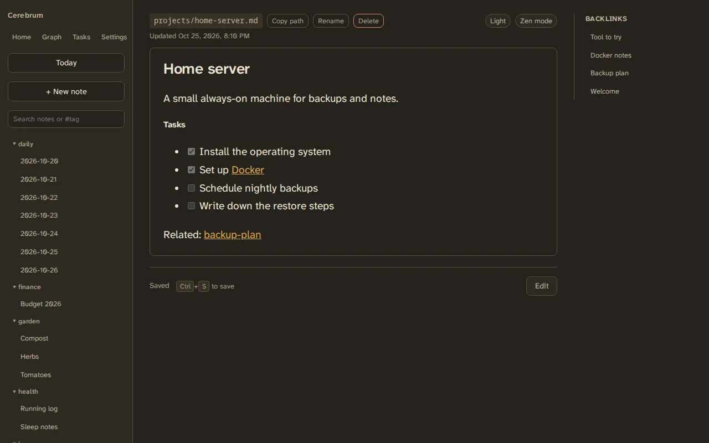
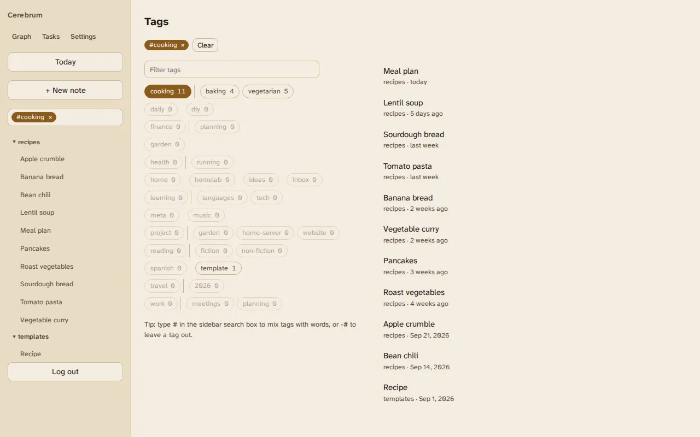
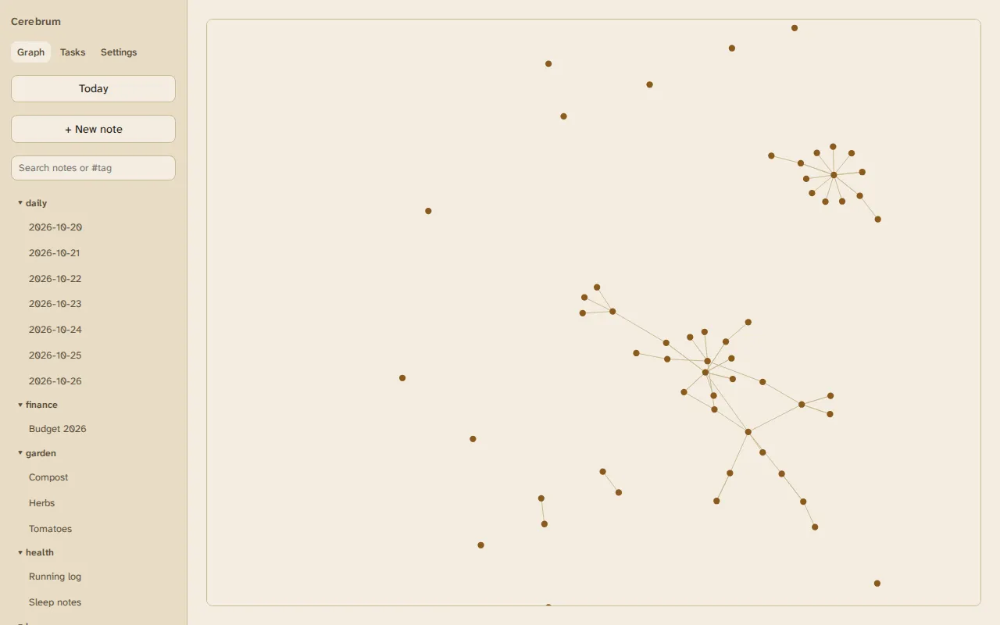

# Cerebrum

A self-hosted second brain. Your notes are plain markdown files in a folder on
your own server, linked to each other, and you reach them from any browser,
your phone or a desktop app. There is no database to migrate away from: stop
using Cerebrum and your notes are still just files.

## What you get

- **Plain files.** Every note is a `.md` file. Edit them in Cerebrum, in your
  editor, or sync them with another tool; Cerebrum picks up changes on its own.
- **Links and a graph.** Link notes with markdown links or `[[wikilinks]]`.
  Backlinks and a graph show how everything connects, and renaming a note keeps
  its links working.
- **Tags, search and tasks.** Full-text search with `#tag` filters, a front page
  that browses by tag, and a task list where you add and tick off the
  checkboxes in every note.
- **On your phone, even offline.** Install it to your home screen; the last
  synced vault stays readable without a connection.
- **Your AI tools can use it.** A built-in MCP server lets assistants such as
  Claude read, search and write your notes with a token you control.

## Is Cerebrum for you?

**A good fit** if you want your notes as plain files on a machine you run,
reachable from a browser, your phone and AI assistants: one person, or a
household or small group sharing one set of notes.

**Not built for** editing without a connection, keeping some notes private from
other accounts on the same server, or running without a server: Cerebrum needs
an always-on machine with Docker. The [FAQ](help/faq.md) has more.

## Where to start

-   **Quick start**

    ---

    From Docker on a home server to Cerebrum on your phone in about
    15 minutes.

    [Start here](quick-start.md)

-   **Install options**

    ---

    The install script, installing by hand, the desktop app and upgrading.

    [Install](install/index.md)

-   **Phone app**

    ---

    Install Cerebrum on Android or iPhone, and what it needs to work offline.

    [Phone](install/phone.md)

-   **Connect an AI assistant**

    ---

    Give Claude or another MCP client access to your notes.

    [Agents](agents/index.md)

-   **Backups**

    ---

    What to back up, and how to restore.

    [Backups](running/backups.md)

-   **Bring your notes**

    ---

    Move notes over from Obsidian, Notion, Logseq, Bear, Joplin, Evernote or
    Apple Notes.

    [Import](import/index.md)

