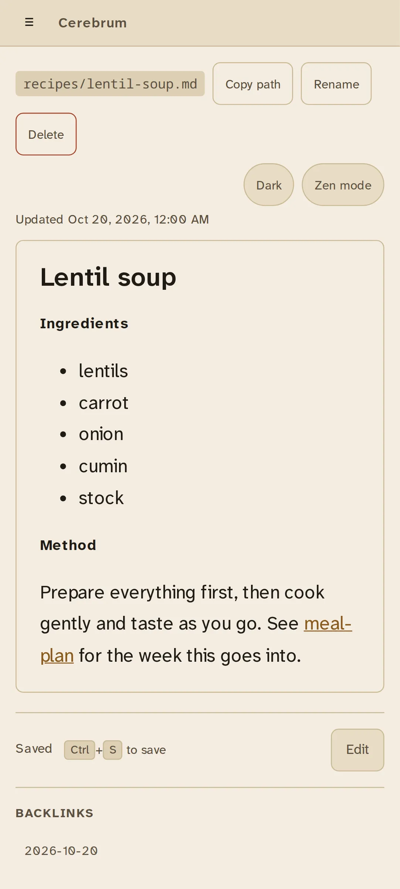
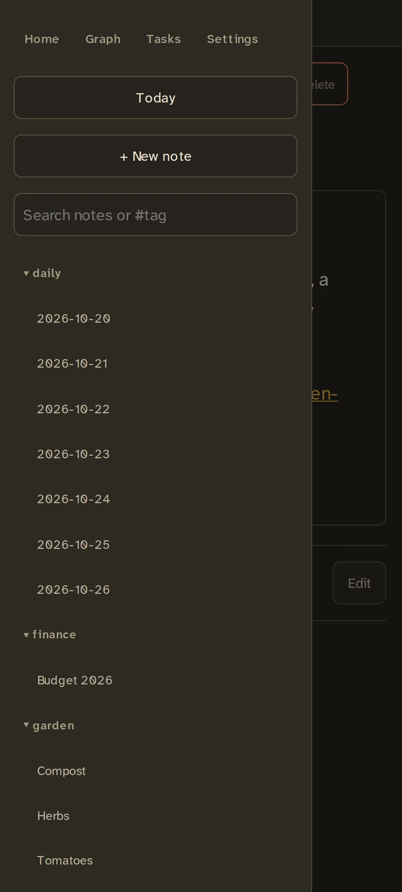

# Phone app

Cerebrum installs from the browser as an app: it gets a home-screen icon, opens
full screen without the browser's toolbars, and keeps your notes readable
offline. There is nothing to download from an app store.

{ width="320" }

## It needs a trusted HTTPS address

Phones only install web apps, and only keep them working offline, from an
address with a certificate the phone trusts. Clicking through a "not secure"
warning is not enough: on Android the app silently fails to install.

So before installing, give Cerebrum a trusted address. The simplest is
Tailscale, as in the [quick start](../quick-start.md#3-give-it-an-https-address-with-tailscale).
[HTTPS](../running/https.md) covers the alternatives.

## Install

1. Open Cerebrum's HTTPS address on the phone and sign in.
2. Then:
    - **Android, Chrome:** browser menu, then **Install app**. Or, inside
      Cerebrum, **Settings**, then **Install app**.
    - **iPhone, Safari:** **Share**, then **Add to Home Screen**. Cerebrum shows
      this hint once, after you open your first note.

The app belongs to that exact address, port included. If the address changes,
install it again from the new one.

## Using it

On a phone, the folder tree and search sit in a drawer behind the menu button.

{ width="320" }

Everything works as in the browser. When the server can't be reached, the app
shows the notes it last synced and doesn't allow edits; see
[Offline use](../features/offline.md).
